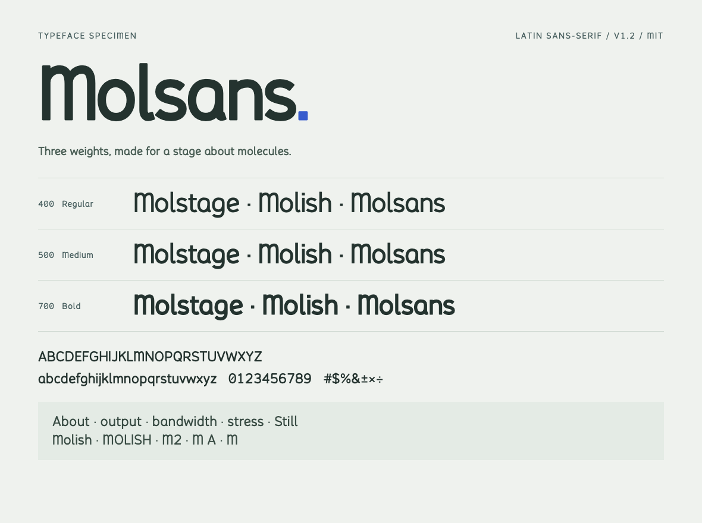

# Molsans

Molsans is a Latin sans-serif typeface designed for [Molstage](https://molstage.com/en/). Its double-arch M, curved lowercase l, and rounded joins give it a quiet signature alongside scientific illustrations.

Molsans 是为 Molstage 设计的拉丁无衬线字体。v1.2 提供 Regular、Medium 和 Bold 三个独立字重，覆盖 113 个字符，包括英文字母、等宽数字、完整 ASCII 标点和常用排版及数学符号。字体不含中文；中英混排时可另配开源中文字体。



[Online specimen and font details / 在线样张](https://molstage.com/molsans)

## Download

| Style | Weight | Desktop | Web |
| --- | ---: | --- | --- |
| Regular | 400 | [TTF](dist/Molsans-Regular.ttf) | [WOFF2](dist/Molsans-Regular.woff2) |
| Medium | 500 | [TTF](dist/Molsans-Medium.ttf) | [WOFF2](dist/Molsans-Medium.woff2) |
| Bold | 700 | [TTF](dist/Molsans-Bold.ttf) | [WOFF2](dist/Molsans-Bold.woff2) |

[Versioned downloads and ZIP archive](https://github.com/Waylon524/Molsans/releases)

## New in v1.2

- The name is now **Molsans**.
- **Regular** retains the v1.1 contours. **Medium** is the slightly heavier face introduced on Molstage. **Bold** uses genuinely heavier outlines and slightly wider spacing for brand wordmarks. None relies on synthetic bold.
- All three keep the additional breathing room in `ut`, `dt`, `rt`, `tt`, and related crossbar pairs, alongside the kerning and punctuation improvements introduced in v1.1.

## Contextual M

Before a lowercase ASCII letter, M uses the shorter of its two double-arch shapes. The taller M is the default in all other positions, including before capitals, digits or spaces, and on its own. Both forms share the same baseline and advance within each weight. This uses OpenType contextual alternates (`calt`); if disabled, only the taller M appears.

## Web use

Host the WOFF2 files and declare each static weight separately. For example:

```css
@font-face {
  font-family: "Molsans";
  src: url("./Molsans-Regular.woff2") format("woff2");
  font-weight: 400;
  font-style: normal;
  font-display: swap;
}
body {
  font-family: "Molsans", "Noto Sans SC", system-ui, sans-serif;
  font-variant-ligatures: contextual;
}
```

## Build from source

Use macOS, the Xcode command-line tools, and Python 3. The vector design lives in [source/build.py](source/build.py); [source/family.py](source/family.py) applies the final spacing, weights and font metadata. The Swift helpers use Core Graphics.

```sh
python3 -m venv .venv
. .venv/bin/activate
python -m pip install -r requirements.txt
./build.sh
python tests/verify.py
```

## License

The fonts and repository material are released under the [MIT License](LICENSE).
