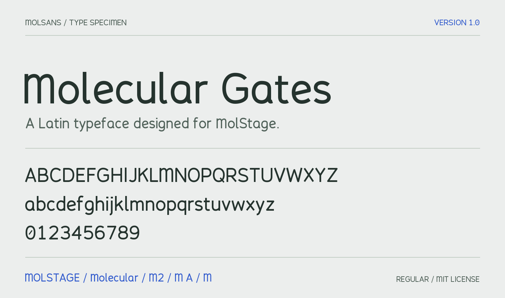

# MolSans

MolSans is a Latin sans-serif typeface designed for [MolStage](https://molstage.com/), a stage for interactive biology animations. Its double-arch capital M, angled lowercase l, and rounded joins are drawn to sit comfortably beside scientific illustrations.

MolSans 是为 MolStage 设计的拉丁无衬线字体。v1.0 提供 Regular 字重、基础英文字母、等宽数字和部分标点。字体不含中文；中英混排时可以搭配原版 Noto Sans SC，仓库不分发中文字体。



## Download

- [MolSans Regular TTF](dist/MolSans-Regular.ttf) for desktop installation.
- [MolSans Regular WOFF2](dist/MolSans-Regular.woff2) for websites.
- [GitHub releases](https://github.com/Waylon524/MolSans/releases) for versioned downloads.

## Contextual M

The taller double-arch M is the default. If the next character is a lowercase ASCII letter, the font uses the original, slightly shorter M. The two forms share the same advance width and baseline. For example, `Molecular` and `Molish` use the shorter form, while `MOLSTAGE`, `M2`, `M A`, and a standalone `M` use the taller one.

This is implemented with OpenType contextual alternates (`calt`). If an application does not support or disables the feature, it will show the taller M everywhere.

## Web use

Download the WOFF2 and serve it with your site.

```css
@font-face {
  font-family: "MolSans";
  src: url("./MolSans-Regular.woff2") format("woff2");
  font-weight: 400;
  font-style: normal;
  font-display: swap;
}
.title {
  font-family: "MolSans", "Noto Sans SC", system-ui, sans-serif;
  font-variant-ligatures: contextual;
}
```

## Build from source

Build on macOS with the Xcode command-line tools and Python 3. The vector construction lives in [source/build.py](source/build.py); the Swift helpers use Core Graphics to create and normalize contours.

```sh
python3 -m venv .venv
. .venv/bin/activate
python -m pip install -r requirements.txt
./build.sh
python tests/verify.py
```

## License

The font files, source, and repository material are released under the [MIT License](LICENSE).
